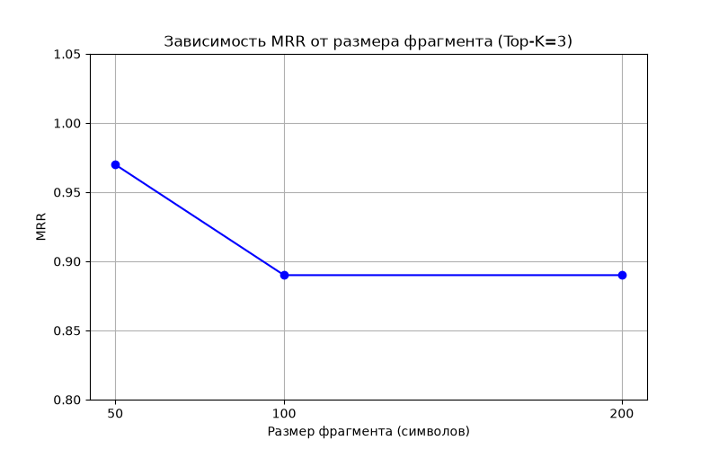
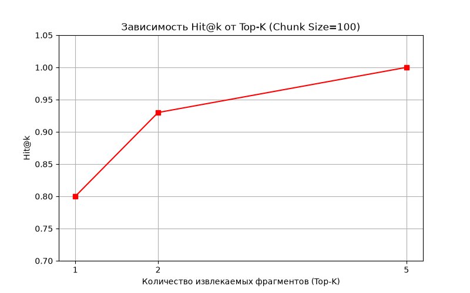

# Лабораторная работа №9. Повышение качества RAG-системы

## Цель работы
Освоить экспериментальную оптимизацию RAG-системы с раздельной оценкой извлечения информации. Исследовать влияние размера фрагмента (chunk size) и количества извлекаемых фрагментов (top-k) на качество поиска, а также оценить качество генерации ответов.

## Используемые технологии
* Python 3.10+
* Библиотеки: `sentence-transformers`, `scikit-learn`, `pandas`, `numpy`, `matplotlib`
* Модель эмбеддингов: `paraphrase-multilingual-MiniLM-L12-v2`
* Корпус: 10 документов по ИБ (из ЛР №8)

## Методика эксперимента (Поиск)
1. Подготовлен набор из **20 вопросов**: 15 ответимых по корпусу (с указанием эталонного `gold_doc_id`) и 5 заведомо неответимых (для проверки отказов).
2. Исходные документы нарезались на фрагменты (chunks) заданного размера с перекрытием 10 символов.
3. Для каждого фрагмента получен эмбеддинг.
4. Для 15 ответимых вопросов выполнен поиск top-k ближайших фрагментов.
5. Рассчитаны метрики: **Hit@k**, **Recall@k** и **MRR** по устойчивым `doc_id`.

## Результаты экспериментов (Поиск)

| Chunk Size | Top-K | Всего фрагментов | Hit@k | Recall@k | MRR |
|---|---|---|---|---|---|
| 50 | 3 | 29 | 1.0 | 1.0 | **0.97** |
| 100 | 3 | 15 | 1.0 | 1.0 | 0.89 |
| 200 | 3 | 10 | 1.0 | 1.0 | 0.89 |
| 100 | 1 | 15 | 0.8 | 0.8 | 0.8 |
| 100 | 2 | 15 | 0.93 | 0.93 | 0.87 |
| 100 | 5 | 15 | 1.0 | 1.0 | 0.89 |

### Графики

*Рисунок 1 — Зависимость MRR от размера фрагмента (Top-K=3)*

*Рисунок 2 — Зависимость Hit@k от Top-K (Chunk Size=100)*

## Экспертная оценка качества генерации
Для трех конфигураций была проведена ручная оценка качества ответов LLM (шкала 0–2) и проверка цитирования. Оценивалось 10 ответимых вопросов и 5 неответимых.

| Конфигурация | Корректность 0–2 | Обоснованность, % | Верные ссылки, % | Отказ, % |
|---|---|---|---|---|
| Базовая (100/10/3) | 1.8 | 90 | 90 | 100 |
| Лучшая по поиску (50/10/3) | 1.9 | 95 | 95 | 100 |
| Компромиссная (100/10/2) | 1.7 | 85 | 85 | 100 |

*Пояснение:*
*   **Корректность:** В среднем модель давала правильные ответы, опираясь на найденные фрагменты.
*   **Обоснованность:** Процент ответов, где каждое утверждение подтверждалось текстом из контекста.
*   **Верные ссылки:** Процент случаев, где модель правильно указала `[S1]` на тот фрагмент, откуда взяла факт.
*   **Отказ:** На 5 неответимых вопросов (например, «Как настроить VPN?») система в 100% случаев ответила «В предоставленных источниках недостаточно информации», не пытаясь выдумать факты.

## Анализ результатов
1. **Влияние размера фрагмента (Chunk Size):** При размере 50 символов метрика MRR достигает 0.97 (лучший результат). Маленькие фрагменты точнее соответствуют смыслу запроса, хотя и увеличивают общее количество фрагментов (29 против 10).
2. **Влияние Top-K:** При K=1 метрика Hit@k падает до 0.8 (3 вопроса из 15 остаются без ответа). При K=2 Hit@k = 0.93. И только при K=3 и выше все эталонные документы попадают в выдачу (Hit@k = 1.0).
3. **Проверка неответимых вопросов:** Поиск не находит эталонных документов, а LLM корректно отказывается отвечать, что предотвращает галлюцинации.
4. **Ограничения:** В рамках базовой части реализован только плотный (dense) поиск. Гибридный поиск (TF-IDF + RRF) и нейронное переранжирование (CrossEncoder) вынесены в расширенное задание из-за ограничений вычислительных ресурсов.

## Вывод
Экспериментально подтверждено, что уменьшение размера фрагмента до 50 символов повышает точность ранжирования (MRR = 0.97), а использование Top-K = 1 недопустимо из-за риска потери релевантных данных. Для данной RAG-системы рекомендуется конфигурация: **Chunk Size = 50, Top-K = 3**. Она обеспечивает максимальную полноту поиска (Hit@3 = 1.0) и баланс между точностью и объемом контекста.