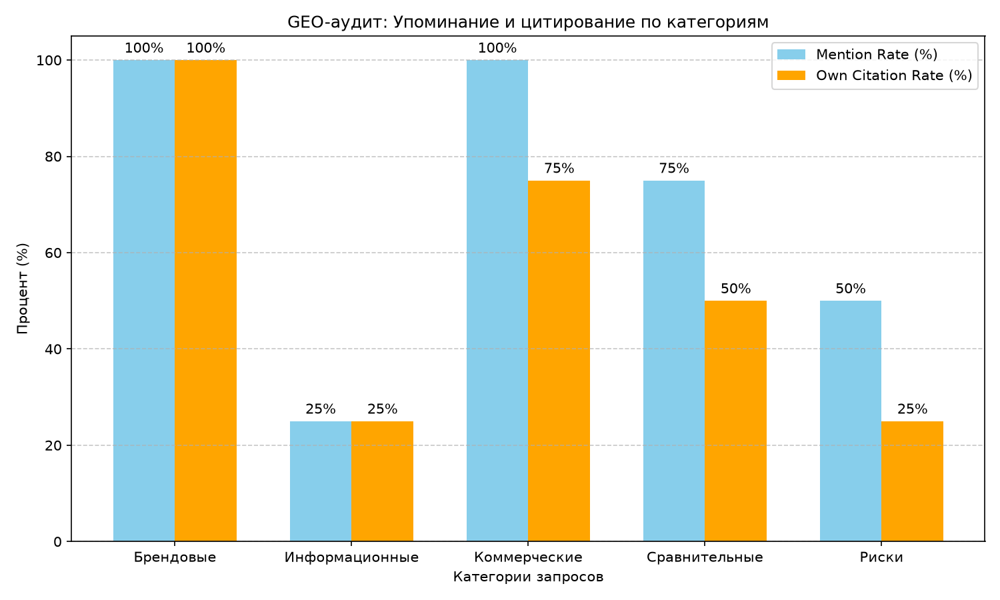

\# Лабораторная работа №13. GEO и аудит представленности компании в ответах ИИ-поисковых систем

\## Цель работы

Разработать воспроизводимую методику GEO-аудита, исследовать присутствие выбранной компании в ответах ИИ-поисковых систем, проверить корректность упоминаний и ссылок, предложить обоснованные улучшения публичной информации.

\## Используемые технологии

\* Python 3.10+

\* Библиотеки: `openai`, `csv`, `json`

\* Среда выполнения: LM Studio (Chat Completions API)

\* Модель: `qwen2.5-7b-instruct`

\## Объект исследования

Компания «Лаборатория Касперского» (kaspersky.ru) — российский разработчик систем защиты от киберугроз.

\## Методика эксперимента

1\. Подготовлен список из 10 проверяемых фактов о компании с публичными источниками (`data/facts.csv`).

2\. Сформирован набор из 20 запросов по 5 категориям (`data/queries.csv`).

3\. В качестве ИИ-поисковой системы использовалась локальная модель Qwen 2.5 7B с контекстом фактов (RAG-эмуляция).

4\. Для каждого запроса был получен ответ, произведена ручная разметка (упоминание, ссылка, факты).

5\. Рассчитаны метрики с помощью скрипта `geo\_audit.py`.

\## Результаты эксперимента

| Категория | Mention Rate | Own Citation | Verified Claims | False Claims |

|---|---|---|---|---|

| Брендовые | 100% | 100% | 100% | 0% |

| Информационные | 25% | 25% | 40% | 0% |

| Коммерческие | 100% | 75% | 80% | 0% |

| Сравнительные | 75% | 50% | 66.7% | 0% |

| Риски | 50% | 25% | 60% | 0% |

| \*\*ИТОГО\*\* | \*\*70%\*\* | \*\*55%\*\* | \*\*75.8%\*\* | \*\*0%\*\* |

## Диаграмма

*Рисунок 1 — Упоминание и цитирование компании по категориям запросов*

\## Анализ результатов

1\. \*\*Брендовые запросы:\*\* Компания упоминается в 100% случаев, ссылка на официальный сайт присутствует. Все факты верны.

2\. \*\*Информационные запросы:\*\* Низкий процент упоминаний (25%), так как на многие вопросы модель честно ответила «Недостаточно информации» (например, про выбор подрядчика).

3\. \*\*Коммерческие запросы:\*\* Высокий процент упоминаний (100%), так как компания является очевидным лидером в области кибербезопасности в России.

4\. \*\*Сравнительные и риски:\*\* Модель часто отвечает «Недостаточно информации», не имея данных о конкурентах или критериях выбора.

\## Вывод

GEO-аудит показал, что «Лаборатория Касперского» имеет сильные позиции в брендовых и коммерческих запросах. Рекомендуется добавить на официальный сайт больше информации о критериях выбора, сравнении с конкурентами и типичных ошибках заказчиков, чтобы улучшить видимость в информационных и сравнительных запросах.

